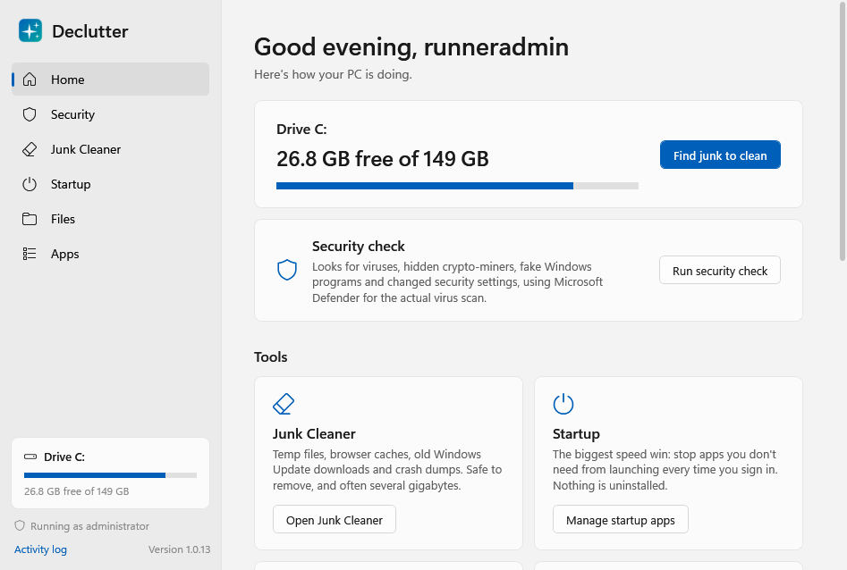
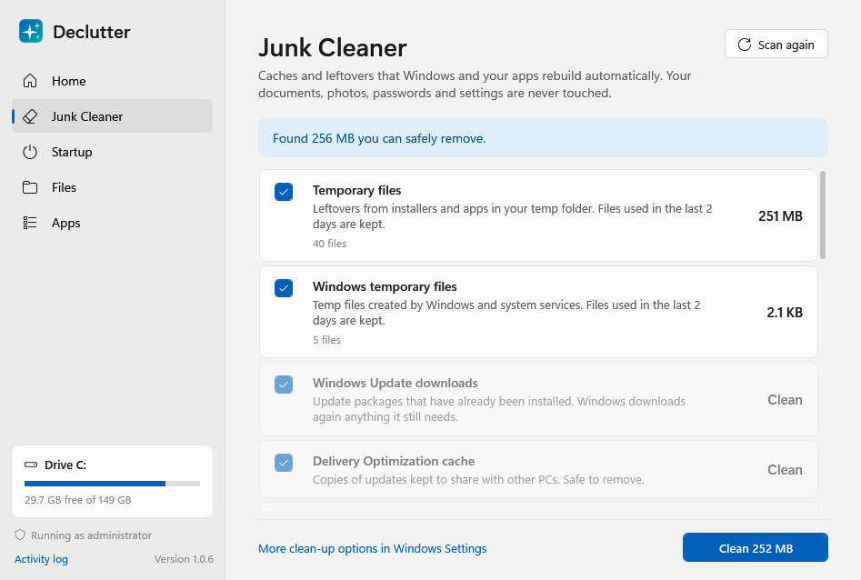
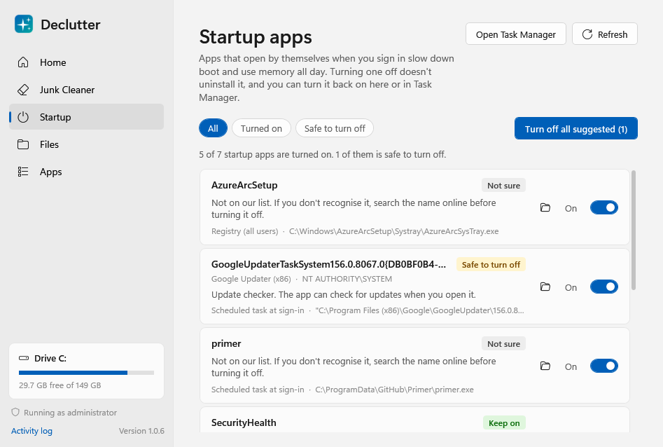
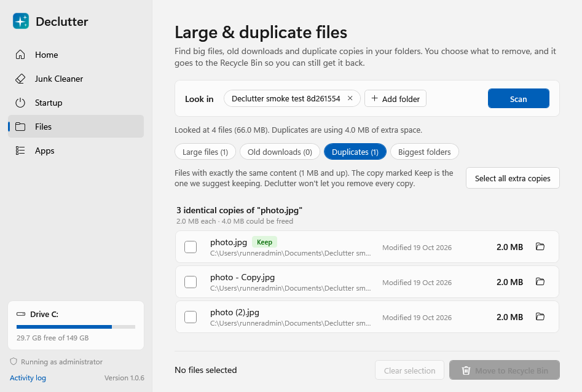
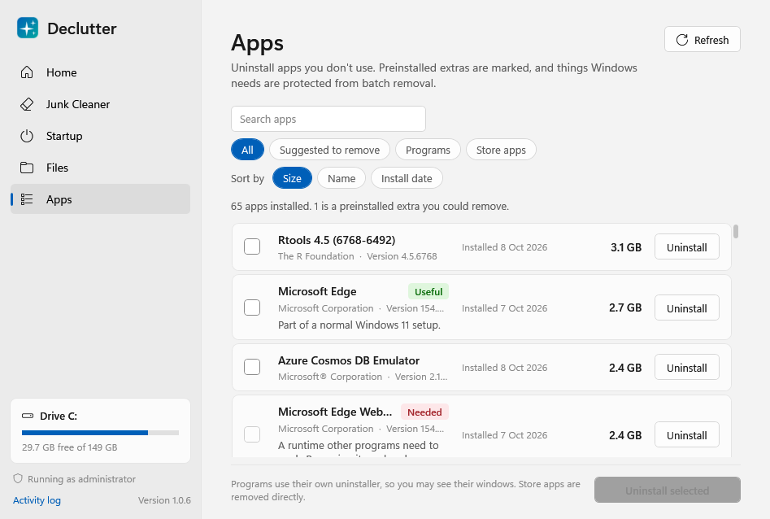

# Declutter

A safe, no-nonsense clean-up tool for Windows 11 (and 10). It frees disk space and makes your PC start faster,
and it never deletes anything you haven't reviewed and confirmed.

| Tool | What it does | Speeds up | Frees space |
|---|---|:-:|:-:|
| **Security check** | Looks for viruses (via Microsoft Defender), hidden crypto-miners, fake Windows programs and tampered settings | ✅ | |
| **Junk Cleaner** | Temp files, browser caches, old Windows Update downloads, crash dumps, Recycle Bin | | ✅ |
| **Startup** | Turns off apps that launch every time you sign in (Spotify, Steam, Edge pre-loading, updaters…) | ✅ | |
| **Files** | Finds large files, old downloads, duplicate copies and your biggest folders | | ✅ |
| **Apps** | Lists every installed app with its size and flags preinstalled bloatware to uninstall | ✅ | ✅ |



## Download and run

1. Open the [**Releases**](../../releases/latest) page and download **`Declutter.exe`**
   (or `Declutter-ARM64.exe` if your laptop has a Snapdragon/ARM processor).
2. Double-click it. There is nothing to install: it's one file you can keep anywhere, or delete when done.
3. Click **Yes** on the administrator prompt. Some caches and all-user startup items need it.
   You can say No; those parts are just switched off.
4. If Windows shows **"Windows protected your PC"**, click **More info → Run anyway**. This happens because
   the app isn't code-signed (signing certificates cost money), not because something is wrong.

## Screenshots

| Junk Cleaner | Startup |
|---|---|
|  |  |
| **Duplicate files** | **Apps** |
|  |  |

Light and dark mode follow your Windows setting. These screenshots are taken automatically by CI on a
fresh Windows machine, which is why the numbers are small.

## Security check

Declutter isn't an antivirus, and doesn't pretend to be. Real virus detection needs definitions that update
every day, and Windows 11 already has a good engine: **Microsoft Defender**. The Security page shows whether
Defender (or your other antivirus) is on and up to date, lists anything it has found, and runs a quick scan or a
definitions update with one click. On top of that it checks for signs of trouble that are easy to miss:

| Check | What it catches |
|---|---|
| **Crypto-miners** | Known miner programs (XMRig, NiceHash, T-Rex…), command lines pointing at mining pools, connections to mining-pool ports, and unsigned programs quietly using lots of CPU |
| **Fake Windows programs** | An `svchost.exe`, `csrss.exe` or `explorer.exe` running from outside the Windows folder, and look-alike names like `scvhost.exe` |
| **Startup tricks** | Startup items that run hidden or encoded PowerShell, mshta, regsvr32 or script files, or programs that start from the Temp folder |
| **Defender exclusions** | Folders or file types Defender has been told to ignore, a favourite trick of malware |
| **Defender history** | Threats that were detected but not removed, or that someone chose to allow |
| **Hosts file & proxy** | Redirected security, update or banking sites, and unexpected proxies |
| **Hidden WMI commands** | WMI event subscriptions, a hiding place for "fileless" malware |
| **Firewall & User Account Control** | Either one switched off |

Every finding explains what it means, how sure we are ("Needs attention" vs "Worth a look"), and offers safe
next steps: **Scan with Defender**, **Turn off at startup**, **Show file**, **Search online** or **End program**.
Declutter never deletes a suspicious file itself; Defender quarantines it safely. Some checks (Defender
exclusions, WMI) need administrator rights.

## How it keeps you safe

Deleting the wrong file is the one thing a clean-up tool must never do, so safety is built in at several layers:

- **Nothing happens without your OK.** Every tool scans first, shows you what it found, and asks before changing anything.
- **Your own files only go to the Recycle Bin.** Anything removed with the Files tool can be restored.
  Only true junk (caches and temp files that apps rebuild) is deleted permanently.
- **A safety check guards every single delete.** Separately from the scanners, each path is checked before it's touched:
  - Junk cleaning may only touch an explicit allow-list of cache and temp folders.
  - Windows, Program Files, ProgramData, drive roots, `System Volume Information`, page/hibernation files and
    your user folders themselves can never be deleted.
  - If your `TEMP` variable points somewhere odd (like `C:\` or your profile), temp cleaning switches itself off.
- **Shortcuts and junctions are never followed.** A link inside a cache folder can't trick the cleaner into
  deleting what it points to.
- **Recent temp files are kept.** Anything used in the last 2 days (10 for Windows Update) is skipped, so
  installers that are running right now aren't broken.
- **Duplicates: you can never delete every copy.** The app refuses a selection that would.
- **OneDrive:** online-only files are skipped (reading them would download them), and you're warned that deleting
  a synced file removes it from OneDrive too.
- **Startup apps are switched off, not deleted.** It uses the same on/off setting as Task Manager, so you can
  undo anything there or in Declutter.
- **Apps are removed with their own uninstaller.** Runtimes and drivers (Visual C++, .NET, Realtek, Intel…)
  are marked **Needed** and can't be batch-selected.
- **Restore point button.** Home → *Create restore point* saves a Windows restore point first if you want one.
- **Activity log.** Everything changed is written to `%LOCALAPPDATA%\Declutter\Logs` (also under *Activity log*
  in the app).

## What actually makes a PC faster

Honest advice, which is also how the app is designed:

1. **Fewer startup apps.** This is the biggest win for boot time and memory. Start with the Startup page's
   *Safe to turn off* filter.
2. **Keep at least 10–15% of the drive free.** Windows slows down and updates fail when the drive is nearly full.
3. **Uninstall apps you don't use.** Many run background services or updaters even when closed.
4. **Restart weekly.** Shut down with Fast Startup isn't a real restart.
5. **Registry cleaners don't help.** They can break things, so Declutter deliberately doesn't include one.

## For developers

Built with C# / .NET 8 and WPF. Three projects:

```
src/
  Declutter.Core/      Platform-neutral logic: safety guard, junk rules, file scanning, duplicate
                       detection, startup/app advice, security checks. Fully unit-tested on any OS.
  Declutter.Windows/   Windows implementations: Recycle Bin and shell APIs, registry, Task Scheduler,
                       Store packages, restore points, WMI/Defender/signature checks.
  Declutter.App/       The WPF app (MVVM). Follows the Windows light/dark setting.
tests/
  Declutter.Core.Tests/     Unit tests, including a full fake Windows folder tree for the safety rules.
  Declutter.Windows.Tests/  Integration tests against real Windows APIs (run in CI on windows-latest).
```

**Build & test**

```powershell
dotnet test tests/Declutter.Core.Tests        # any OS
dotnet test tests/Declutter.Windows.Tests     # Windows only
dotnet run --project src/Declutter.App
```

**Publish a single exe**

```powershell
dotnet publish src/Declutter.App -c Release -r win-x64 --self-contained `
  -p:PublishSingleFile=true -p:IncludeNativeLibrariesForSelfExtract=true -p:EnableCompressionInSingleFile=true
```

**CI** (`.github/workflows/build.yml`) runs on every push: both test suites, x64 + ARM64 builds, and a
smoke test that launches the real app (`Declutter.exe --smoke-test <dir>`). The smoke test opens every
page, runs the read-only scans, recycles test duplicates in a throwaway folder, fails on any XAML binding
error, and uploads screenshots as a build artifact. Pushes to the default branch publish a GitHub Release.

### Adding a junk location

Add a `JunkRule` to `src/Declutter.Core/Junk/JunkCatalog.cs`. If it's outside per-user AppData, also add its
folder to the allow-list in `SafetyGuard.BuildJunkAllowList`. The test `Catalog_EveryRule_PointsInsideTheGuardsAllowList`
fails until both agree, so a new rule can't accidentally widen what gets deleted.
