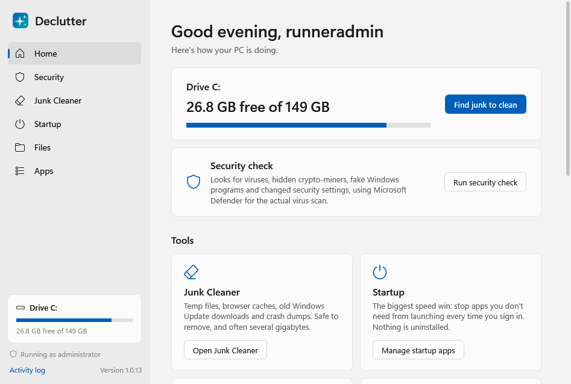
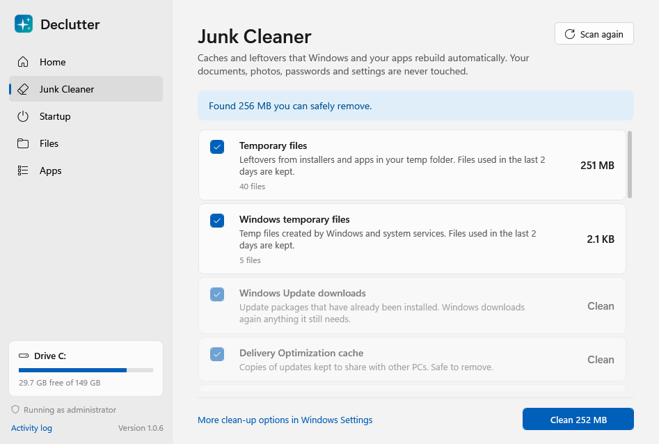
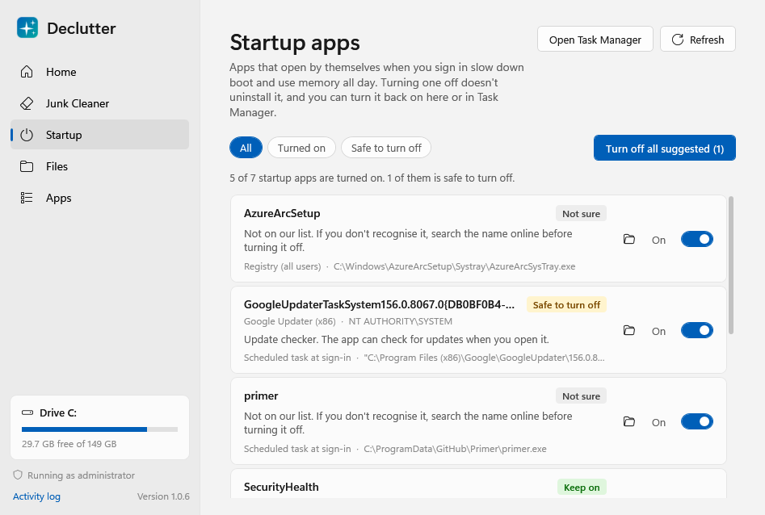
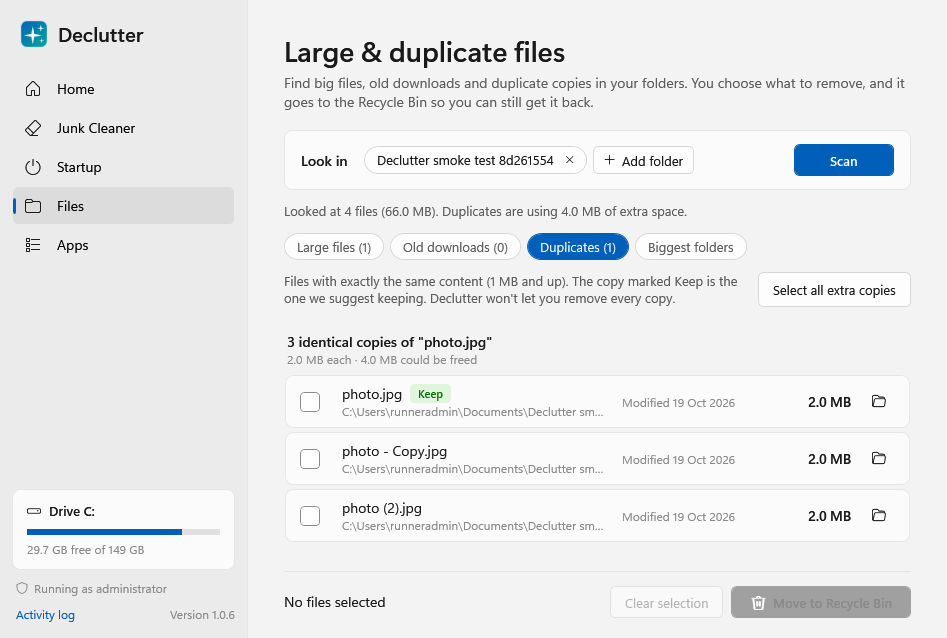
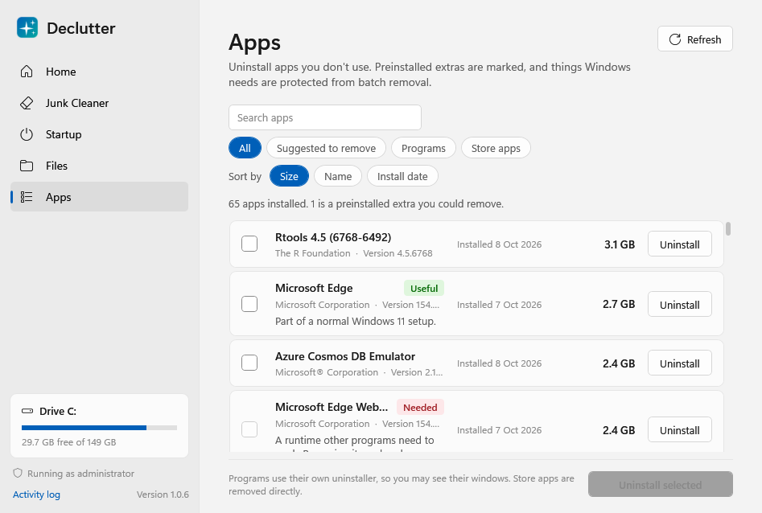
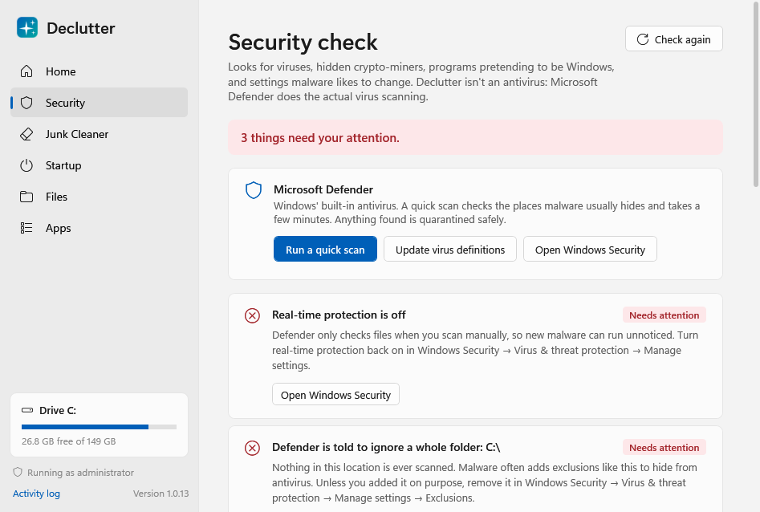

# Declutter

A safe, no-nonsense clean-up tool for Windows 11 (and 10). It frees disk space and makes your PC start faster,
and it never deletes anything you haven't reviewed and confirmed.

| Tool | What it does | Speeds up | Frees space |
|---|---|:-:|:-:|
| **Home: PC health score** | One-click check-up that scores the PC out of 100, lists every lost point with a button to fix it, and shows 90-day trends | | |
| **Security check** | Looks for viruses (via Microsoft Defender), hidden crypto-miners, fake Windows programs and tampered settings | ✅ | |
| **Protection** | Are your files backed up, is the drive encrypted, is Windows up to date and still supported, and what can each browser extension see | | |
| **Health** | How your drives and battery are holding up: SSD wear, temperature, errors, battery capacity left | | |
| **Speed** | Why the PC is slow to start (Windows' own boot timings), app services that run all day, and honest hardware advice | ✅ | |
| **Junk Cleaner** | Temp files, browser caches, old Windows Update downloads, crash dumps, Recycle Bin | | ✅ |
| **Startup** | Turns off apps that launch every time you sign in (Spotify, Steam, Edge pre-loading, updaters…) | ✅ | |
| **Files** | Finds large files, old downloads, duplicate copies and your biggest folders | | ✅ |
| **Apps** | Lists every installed app with its size and flags preinstalled bloatware to uninstall | ✅ | ✅ |
| **App updates** | Lists apps with newer versions (via Windows' built-in winget) and updates the ones you pick | | |
| **This PC** | Model, serial number (with a warranty-lookup button), processor, memory, drives, and a shareable report | | |

Every list has a **What is this?** button that can ask Claude, Anthropic's AI, for a plain-English explanation
(optional, uses your own API key, see [Explain with AI](#explain-with-ai-optional)).



## Download and run

1. Open the [**Releases**](../../releases/latest) page and download **`Declutter.exe`**
   (or `Declutter-ARM64.exe` if your laptop has a Snapdragon/ARM processor).
2. Double-click it. There is nothing to install: it's one file you can keep anywhere, or delete when done.
3. Click **Yes** on the administrator prompt. Some caches and all-user startup items need it.
   You can say No; those parts are just switched off.
4. If Windows shows **"Windows protected your PC"**, click **More info → Run anyway**. This happens because
   the app isn't code-signed (signing certificates cost money), not because something is wrong.
   [How code signing would fix this](docs/code-signing.md).

## Screenshots

| Junk Cleaner | Startup |
|---|---|
|  |  |
| **Duplicate files** | **Apps** |
|  |  |

Light and dark mode follow your Windows setting (or pick one in Settings), and Windows High Contrast themes are honoured. These screenshots are taken automatically by CI on a
fresh Windows machine, which is why the numbers are small.

## Security check



Declutter isn't an antivirus, and doesn't pretend to be. Real virus detection needs definitions that update
every day, and Windows 11 already has a good engine: **Microsoft Defender**. The Security page shows whether
Defender (or your other antivirus) is on and up to date, lists anything it has found, and runs a quick scan or a
definitions update with one click. On top of that it checks for signs of trouble that are easy to miss:

| Check | What it catches |
|---|---|
| **Crypto-miners** | Known miner programs (XMRig, NiceHash, T-Rex…), command lines pointing at mining pools, connections to mining-pool ports, and unsigned programs quietly using lots of CPU |
| **Fake Windows programs** | An `svchost.exe`, `csrss.exe` or `explorer.exe` running from outside the Windows folder, and look-alike names like `scvhost.exe` |
| **Startup tricks** | Startup items that run hidden or encoded PowerShell, mshta, regsvr32 or script files, or programs that start from the Temp folder |
| **Defender exclusions** | Folders or file types Defender has been told to ignore, a favourite trick of malware |
| **Defender history** | Threats that were detected but not removed, or that someone chose to allow |
| **Hosts file & proxy** | Redirected security, update or banking sites, and unexpected proxies |
| **Hidden WMI commands** | WMI event subscriptions, a hiding place for "fileless" malware |
| **Firewall & User Account Control** | Either one switched off |

Every finding explains what it means, how sure we are ("Needs attention" vs "Worth a look"), and offers safe
next steps: **Scan with Defender**, **Turn off at startup**, **Show file**, **Search online** or **End program**.
Declutter never deletes a suspicious file itself; Defender quarantines it safely. Some checks (Defender
exclusions, WMI) need administrator rights.

## Drive & battery health

Reads Windows' own health data, the same numbers Windows' storage and power tools use:

- **Drives:** Windows' health verdict (which includes the drive's own failure prediction), how much of an
  SSD's rated lifetime of writes is used up, temperature, hours powered on and uncorrectable errors. Each drive
  gets a plain verdict (Good / Fair / Needs attention) with "back up now" advice when it matters. If Windows
  runs from a spinning hard drive, you get the tip that an SSD is the biggest upgrade you can make.
- **Battery:** how much of its original charge a full charge still holds, charge cycles, the charge right now,
  and a button for Windows' detailed battery report.

Wear, temperature and error counts need administrator rights; the rest works without.

## Updates

Declutter checks GitHub for a newer release once a day (and whenever you click **Check for updates** at the
bottom of the sidebar). When there is one, an **Update now** button appears. Clicking it:

1. downloads the version for your processor (x64 or ARM64), only ever from GitHub over HTTPS;
2. checks the file's size and SHA-256 fingerprint against what GitHub publishes, and that it's a Windows program;
3. swaps it in (the old copy is kept until the new one has started, and put back if anything fails), then restarts.

Nothing installs without your click. If Declutter is in a folder it can't write to, it offers the download page instead.

## Protection

Four questions that matter more than any clean-up:

| Check | What it looks at |
|---|---|
| **Backup** | OneDrive folder backup (Desktop, Documents, Pictures), File History and when it last ran, and well-known backup apps |
| **Device security** | BitLocker / device encryption (important on a laptop that could be stolen), Secure Boot and the TPM |
| **Windows Update** | When updates last installed, a restart waiting to finish an update, and whether your Windows version still gets security fixes |
| **Browser extensions** | Every extension in Edge, Chrome, Brave, Vivaldi, Opera and Firefox, rated by how much it can see (all sites vs a few), and whether it came from the official store |

Each card explains what it found and links straight to the right Windows setting. Encryption and TPM details need administrator rights.

## Speed: why is my PC slow to start?

Windows records how long every start-up took and which programs or drivers slowed it down. The Speed page reads that
log (administrator rights needed) and shows your typical start-up time, the trend, and the repeat offenders. It also
lists background services that apps install to run all day; updaters and usage-reporting helpers can safely be set to
**Manual** (they start when their app needs them), and Declutter remembers the original setting so **Undo** puts it back.
Hardware advice is honest: an SSD if Windows is on a spinning disk, more memory only if you actually run short.

## PC health score and history

**Run a check-up** on Home runs every read-only check and gives a score out of 100. It starts at 100 and loses points
only for specific, fixable things (a security finding, no backup, a nearly full drive, a failing drive, too many
startup apps, a slow start, outdated apps, weeks without a restart), each with a button to the page that fixes it.

Declutter keeps a small daily history on this PC (free space, start-up time, battery health, score) to draw 90-day
trends and warn you before the drive fills up ("at the rate it's been filling up, your drive will be full in about 6
weeks"). Turn it off or clear it in **Settings**.

## Explain with AI (optional)

Not sure what "Contoso Update Helper" or a browser extension is? **What is this?** asks Claude for a short,
plain-English explanation and a suggestion (keep it, fine to turn off, look into this…).

- **Off until you add a key.** It uses your own Anthropic API key (Settings → *Explain with AI*; get one at
  [console.anthropic.com](https://console.anthropic.com/settings/keys)). Each answer costs a fraction of a cent.
- **The key is encrypted** with Windows' data protection, so only your Windows account on this PC can read it.
- **You see exactly what's sent** before anything is sent: just the one item you clicked (name, publisher, path),
  with your user name and user folder removed. Nothing else on your PC leaves it.
- Answers come from AI and can be wrong, so Declutter says so under each one.

## Shareable report

**This PC → Create report** writes one HTML file (in `Documents\Declutter reports`) covering the system, storage and
health, security, protection, speed, startup apps and installed apps. It's handy to send to whoever helps you with
your PC. Your user name and user folder are removed from it.

## Settings and accessibility

- Theme: match Windows, light or dark, switching instantly; Windows High Contrast colours are used automatically.
- Turn off the daily update check or the history, clear the history, and open the folder where Declutter keeps
  its settings, history and logs (`%LOCALAPPDATA%\Declutter`).
- Everything works from the keyboard, buttons and toggles have screen-reader names, and CI checks that every piece
  of text in every screenshot meets WCAG contrast in both light and dark themes.

## Privacy

Declutter has no account, no telemetry and no ads. It only goes online to check GitHub for updates (can be turned
off), when you click **Update apps** (winget downloads from each app's publisher) and when you ask Claude to explain
something with your own key.

## How it keeps you safe

Deleting the wrong file is the one thing a clean-up tool must never do, so safety is built in at several layers:

- **Nothing happens without your OK.** Every tool scans first, shows you what it found, and asks before changing anything.
- **Your own files only go to the Recycle Bin.** Anything removed with the Files tool can be restored.
  Only true junk (caches and temp files that apps rebuild) is deleted permanently.
- **A safety check guards every single delete.** Separately from the scanners, each path is checked before it's touched:
  - Junk cleaning may only touch an explicit allow-list of cache and temp folders.
  - Windows, Program Files, ProgramData, drive roots, `System Volume Information`, page/hibernation files and
    your user folders themselves can never be deleted.
  - If your `TEMP` variable points somewhere odd (like `C:\` or your profile), temp cleaning switches itself off.
- **Shortcuts and junctions are never followed.** A link inside a cache folder can't trick the cleaner into
  deleting what it points to.
- **Recent temp files are kept.** Anything used in the last 2 days (10 for Windows Update) is skipped, so
  installers that are running right now aren't broken.
- **Duplicates: you can never delete every copy.** The app refuses a selection that would.
- **OneDrive:** online-only files are skipped (reading them would download them), and you're warned that deleting
  a synced file removes it from OneDrive too.
- **Startup apps are switched off, not deleted.** It uses the same on/off setting as Task Manager, so you can
  undo anything there or in Declutter.
- **Apps are removed with their own uninstaller.** Runtimes and drivers (Visual C++, .NET, Realtek, Intel…)
  are marked **Needed** and can't be batch-selected.
- **Restore point button.** Home → *Create restore point* saves a Windows restore point first if you want one.
- **Service changes can be undone.** Declutter only ever sets an app's service to Manual (never Disabled), and
  remembers the original setting for **Undo**.
- **Activity log.** Everything changed is written to `%LOCALAPPDATA%\Declutter\Logs` (also under *Activity log*
  in the app).

## What actually makes a PC faster

Honest advice, which is also how the app is designed:

1. **Fewer startup apps.** This is the biggest win for boot time and memory. Start with the Startup page's
   *Safe to turn off* filter.
2. **Keep at least 10–15% of the drive free.** Windows slows down and updates fail when the drive is nearly full.
3. **Uninstall apps you don't use.** Many run background services or updaters even when closed.
4. **Restart weekly.** Shut down with Fast Startup isn't a real restart.
5. **Registry cleaners don't help.** They can break things, so Declutter deliberately doesn't include one.

## For developers

Built with C# / .NET 8 and WPF. Three projects:

```
src/
  Declutter.Core/      Platform-neutral logic: safety guard, junk rules, file scanning, duplicate
                       detection, startup/app advice, security checks. Fully unit-tested on any OS.
  Declutter.Windows/   Windows implementations: Recycle Bin and shell APIs, registry, Task Scheduler,
                       Store packages, restore points, WMI/Defender/signature checks.
  Declutter.App/       The WPF app (MVVM). Follows the Windows light/dark setting.
tests/
  Declutter.Core.Tests/     Unit tests, including a full fake Windows folder tree for the safety rules.
  Declutter.Windows.Tests/  Integration tests against real Windows APIs (run in CI on windows-latest).
```

**Build & test**

```powershell
dotnet test tests/Declutter.Core.Tests        # any OS
dotnet test tests/Declutter.Windows.Tests     # Windows only
dotnet run --project src/Declutter.App
```

**Publish a single exe**

```powershell
dotnet publish src/Declutter.App -c Release -r win-x64 --self-contained `
  -p:PublishSingleFile=true -p:IncludeNativeLibrariesForSelfExtract=true -p:EnableCompressionInSingleFile=true
```

**CI** (`.github/workflows/build.yml`) runs on every push: both test suites, x64 + ARM64 builds, and a
smoke test that launches the real app (`Declutter.exe --smoke-test <dir> --theme light|dark`), once per theme. The
smoke test opens every page, runs the read-only scans and a full check-up, recycles test duplicates in a throwaway
folder, creates a report and checks your user name isn't in it, switches theme live, fails on any XAML binding error
or on any text below WCAG contrast, and uploads screenshots as a build artifact. Pushes to the default branch publish a GitHub Release.

### Adding a junk location

Add a `JunkRule` to `src/Declutter.Core/Junk/JunkCatalog.cs`. If it's outside per-user AppData, also add its
folder to the allow-list in `SafetyGuard.BuildJunkAllowList`. The test `Catalog_EveryRule_PointsInsideTheGuardsAllowList`
fails until both agree, so a new rule can't accidentally widen what gets deleted.
